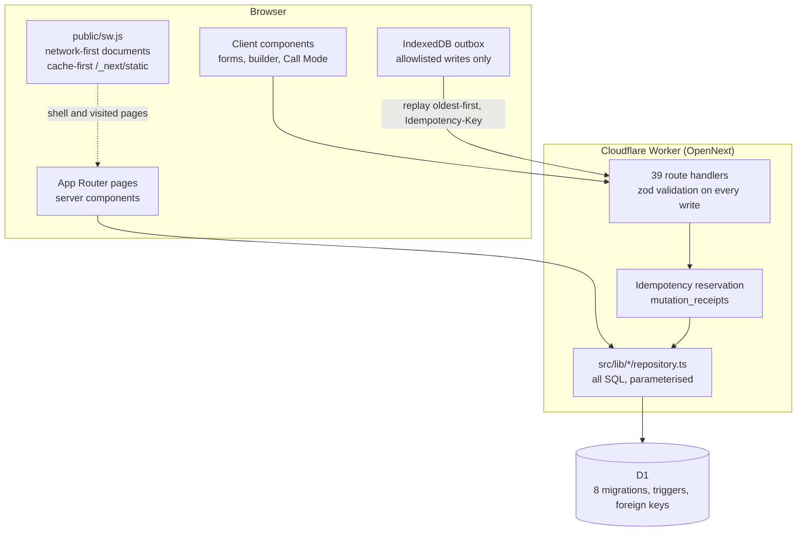

# Leads Master

A workspace for one person who sells websites by phone. It holds the leads, the branching call playbooks, the calls, the follow-ups those calls create, the quotations, and the reporting — all keyed to the same record in one Cloudflare D1 database.

What it replaces: a spreadsheet of prospects, three PDFs of prices, a notebook of call-backs, and a WhatsApp thread that is the only place the last conversation exists.

> [!WARNING]
> **There is no authentication.** No `owner_id`, no login, no per-user isolation: anyone who can reach a deployment can read and edit every lead, call, quotation and Callbook, plus the guide data behind them. Cloning the repository is safe. Exposing a deployment is not, until Cloudflare Access, a private network or real authentication sits in front of it. See [Deploy, then lock the door](#deploy-then-lock-the-door).

## Start here

Three ways in, depending on who you are. Every link below is a section of this document.

| If you are | Read | You will get |
| --- | --- | --- |
| **Reviewing the code** | [Seven rules](#seven-rules-the-interface-cannot-break) → [Architecture](#architecture) → [Review route](#review-route) | The seven decisions that carry the app, and the six places that prove them |
| **Running it** | [Run it](#run-it) → [What is in it](#what-is-in-it) → [Troubleshooting](#troubleshooting) | A local instance with seeded guide data, and the order to click in |
| **Thinking about deploying** | [Deploy, then lock the door](#deploy-then-lock-the-door) → [Refusals, and gaps](#refusals-and-gaps) | The five commands, then the nine refusals and ten gaps |

| Measured on this checkout, 3 November 2026 | |
| --- | --- |
| Tests | 257 passing in 20 files, 12.2 s |
| `npm run lint` / `typecheck` | clean |
| Pages / JSON routes | 26 / 39 |
| D1 migrations | 8 |

Commands that reproduce those numbers are in [Measured on this checkout](#measured-on-this-checkout). Nothing in this document is a projection.

## One shift, in one record

A shift runs left to right. Each step writes to the table beside it, and every step is keyed on the same fan-out of ids, so the quote at the end can name the call that caused it.

```
  lead            playbook          call             follow-up         quotation        report
    │                 │                │                  │                 │              │
  leads          callbooks +       call_sessions     follow_ups        quotes +        reads all
  (market,       call_nodes +      + step log        (due date,        line items +    four tables
   niche,        call_branches     + notes           type, status)     status events   again
   status)                                                             (frozen prices)
    └─────────────────┴────────────────┴──────────────────┴─────────────────┴──────────────┘
                                   one lead id, one D1 database
```

Three principles, in the order a request meets them:

1. **Arithmetic and integrity live in the database.** Money is integer minor units, a trigger rejects a line total that is not `quantity × unit price`, and a quote number comes from one atomic counter.
2. **Lifecycle rules live on the server.** Status transitions, market and niche validity, and "no new follow-up for a do-not-contact lead" are checked in a route handler before anything is written.
3. **The browser is optimistic and forgetful.** It caches what it has seen, queues only the writes it can replay safely, and says so when it cannot.

## What it replaces

Cold-calling small businesses for website work is a bookkeeping problem in a sales costume. The calls are the easy part; what surrounds them is not.

| The pain | What it costs |
| --- | --- |
| The script is improvised every call | A good answer to "we already have a website" is learned once, then lost when that person leaves |
| Prices come from a PDF, or from memory | Two prospects get two different quotes for the same work |
| Follow-ups are written on paper | The interested lead goes cold because nobody called back on Thursday |
| Call notes end up in four places | "How many conversations did we actually have last month?" has no answer |
| Nothing records why a quote was priced that way | Repricing the catalog silently rewrites deals that were already sent |
| The same prospect is entered twice | Two callers work the same business, and nobody notices |

None of these are UI problems. They are the reason this app puts its rules in SQL and treats the screens as a view of them.

## What is in it

Eleven modules, all implemented against D1. There are no mock endpoints and no success states that exist only in the UI.

| Module | What it does | Where |
| --- | --- | --- |
| **Leads** | Search, filter by market, niche, status, follow-up state, website recorded, contacted; six sort orders and SQL pagination. Duplicate warnings on phone, email, domain and name+city. Deletion is refused while call history exists; a do-not-contact lead cannot be given a new follow-up. | `/leads` |
| **Call playbooks** | Library, create from scratch or from one of ten templates, graph builder with a node inspector, live validation, preview, publish as a snapshot, duplicate, archive. | `/callbooks` |
| **Call mode** | Runs the *published* snapshot one step at a time: copyable script, delivery tips, response buttons, back, unexpected answers, quick notes, and a panel of the market, niche and package prices. | `/calls/[id]` |
| **Call history** | Callbook runs and manually logged calls in one searchable list, newest first, with a second call loggable from any row. | `/calls` |
| **Pricing library** | Package cards and comparison, niche-price grid, niche catalog with source child labels, WIB calling schedule, objectives, objections and tools — all editable. | `/dashboard/pricing` |
| **Session planner** | Market, schedule block, niche, date, objective; saves the preparation snapshot; reopen, edit, duplicate, delete, print. | `/dashboard/sessions` |
| **Quote builder** | Server-priced quotations from the lead's own market, frozen at save time, `draft → sent → accepted / rejected` (plus `cancelled`), print view. | `/quotes` |
| **Analytics** | Calls, conversations, interested leads, follow-ups and quotations over a WIB period with a comparison window, a cohort funnel, a daily trend, an outcome histogram and per-currency totals. | `/analytics` |
| **Automation** | Five deterministic rules, evaluated on demand, feeding an in-app reminder queue and a run log. | `/automation` |
| **Guide data editor** | Prices, niche rows, schedules, objectives, objections and tools, plus the seed-validation report. | `/dashboard/settings/guide-data` |
| **Offline use** | Installable shell, cached visited pages, and an outbox for the writes that are safe to replay. | app-wide |

A fresh installation contains the guide data and nothing else — no sample leads, calls, quotes or Callbooks. [First run](#first-run-in-the-order-the-app-expects) says what to do about that.

### Pages and JSON

26 pages (`page.tsx`) and 39 route handlers (`route.ts`). Every write validates its body with `zod` before it reaches a repository.

| Area | Routes |
| --- | --- |
| Dashboard | `/dashboard` — market cards, pipeline counts, follow-ups due and overdue, pipeline per currency, latest sessions |
| Pricing and sessions | `/dashboard/pricing`, `/dashboard/pricing/[marketCode]`, `/dashboard/sessions`, `/new`, `/[id]`, `/[id]/edit` |
| Guide data | `/dashboard/settings/guide-data` |
| Leads | `/leads`, `/leads/new`, `/leads/[id]`, `/leads/[id]/edit` |
| Callbooks | `/callbooks`, `/callbooks/new`, `/callbooks/[id]`, `/callbooks/[id]/preview` |
| Calls | `/calls`, `/calls/[id]`, `/calls/[id]/summary` |
| Quotes | `/quotes`, `/quotes/new`, `/quotes/[id]`, `/quotes/[id]/edit` |
| Reporting | `/analytics`, `/automation`, plus the static `/offline.html` fallback |

| Endpoint group | Handlers | Paths |
| --- | --- | --- |
| Leads and follow-ups | 6 | `/api/leads`, `/[id]`, `/[id]/calls`, `/[id]/follow-ups`, `/duplicates`, `/api/follow-ups/[id]` |
| Callbooks | 7 | `/api/callbooks`, `/[id]`, `/[id]/graph`, `/[id]/publish`, `/[id]/duplicate`, `/[id]/archive`, `/[id]/sessions` |
| Call sessions | 8 | `/api/sessions`, `/[id]`, `/[id]/advance`, `/back`, `/notes`, `/unexpected`, `/finish`, `/duplicate` |
| Quotations | 5 | `/api/quotes`, `/[id]`, `/[id]/status`, `/[id]/duplicate`, `/[id]/refresh-prices` |
| Guide data | 11 | `/api/markets/[id]`, `/api/schedules/[id]`, `/api/niches/…`, `/api/pricing/…`, `/api/guide-data/[resource][/[id]]` |
| Automation | 2 | `/api/automation/run`, `/api/automation/rules/[key]` |

## Seven rules the interface cannot break

Each of these is enforced somewhere a user cannot reach past: the database, a pure function with two callers, or a server route. The screens are allowed to be optimistic because the answer is re-derived anyway.

### 1. A playbook is a graph, and publishing is a snapshot

A message step owns its responses; each response points at the next step; many responses may point at the same step. Ids are UUIDs, so retitling a step never breaks a link.

`validateGraph()` is pure and runs twice — live in the builder, and on the server before publishing — so the two cannot disagree. It **blocks** a missing start step, empty titles or scripts, steps with no responses, unconnected responses, missing or self-referencing targets, responses on outcome steps, and missing outcome categories. It **warns** about repetitions and unreachable steps.

A loop is a warning, not an error, because real calls return to earlier ground ("what's included?" asked twice, "so how much?" after the price). Termination comes from construction rather than from banning cycles: every traversal carries a visited set, and Call Mode advances exactly one response at a time.

Publishing stores an immutable `published_snapshot_json`, a `published_version` and a hash of the draft graph; the hash is what drives the "unpublished changes" badge. The write is guarded by `WHERE published_version = ?`, so two publishes cannot interleave.

### 2. A call runs on the snapshot; the step log decides where it stands

Starting a call copies the published snapshot into the session row. Editing the Callbook afterwards cannot change an active or a historical call.

Position is not a stored pointer that can drift. It is derived by folding an append-only `call_session_steps` log; `path_json` and `current_node_id` are caches written in the same transaction. Going back appends a `back` event, so choosing a different response afterwards replaces the abandoned route without rewriting history.

### 3. Money is an integer, and the server recalculates it

Quotation amounts are integer **minor units** with the currency's own exponent — `IDR: 0`, `AUD: 2`, `USD: 2` — and percentage discounts are basis points. No float reaches the database.

- The browser never submits a total. `POST /api/quotes` and `PATCH /api/quotes/[id]` re-read the price rows and run the same `calculateQuoteTotals()` that the form preview, the document and the print view use.
- A trigger rejects any line whose total is not `quantity × unit_price_minor`.
- A trigger rejects a line item whose currency differs from the quote's. One quote, one currency, no conversion anywhere.
- `DLC-<year>-####` comes from one atomic UPSERT on `quote_number_counters`, never from `COUNT(*)`.

**A saved quote is frozen.** Client details, package name, price, timeline, features, terms and line items are snapshotted at save time, so a later catalog change does not touch it. A **draft** shows the drift as `saved → current` and re-prices only on an explicit confirmation (`/refresh-prices`); a **sent** quote is never re-priced.

### 4. An offline write lands once, or not at all

The service worker never touches `/api/`. Replaying a request from a worker would duplicate calls, so writes are queued by the application, which knows what is safe to replay:

```ts
// src/lib/offline/policy.ts — the whole allowlist
export const QUEUEABLE_WRITES = [
  { method: "POST",  pattern: /^\/api\/leads$/ },
  { method: "PATCH", pattern: /^\/api\/leads\/[^/]+$/ },
  { method: "POST",  pattern: /^\/api\/leads\/[^/]+\/calls$/ },
  { method: "PATCH", pattern: /^\/api\/follow-ups\/[^/]+$/ },
  { method: "POST",  pattern: /^\/api\/sessions\/[^/]+\/(advance|back|notes|unexpected|finish)$/ },
];
```

Everything else stays online, because saving a graph, publishing, creating a quotation or editing guide data depends on server validation the browser cannot reproduce.

Each queued record carries an `Idempotency-Key`, and `src/lib/api/idempotency.ts` runs the handler at most once per key. The guarantee is a **reservation, not a lookup**: the first request inserts a receipt with `status = 0` and a private nonce, then re-reads it; whoever's nonce is stored runs the handler, everyone else replays the stored response or is told the write is still in flight. Two simultaneous replays therefore cannot both run, and a refused write releases its key so a corrected retry still works.

A 5xx, 408 or 429 keeps the record queued and stops the flush. Any other 4xx is a decision about the request, so it is surfaced with **Retry** and **Discard** instead of being retried forever. Flushes are attempted on `online`, on tab focus and on visibility change; the status bar above the content appears only when there is something to say.

### 5. One follow-up rule, five screens

`due_at` is stored two ways: as a calendar day (lead forms) and as a full UTC instant (a Callbook call asks for a date *and* a time). Comparing them directly produces the classic bug where a follow-up is "due today" on the dashboard and "overdue" on the lead.

`src/lib/leads/follow-up-time.ts` is the only place that decides, and it compares days in the reporting zone (WIB). The dashboard counters, the lead badge, the lead-list filters, Analytics and the automation rules all call it. A follow-up due today is not overdue and still counts as a next action, so it suppresses the stale-lead and "interested with no next action" reminders. `follow-up-consistency.test.ts` pins those screens to each other.

### 6. Guide data has one copy, and a session keeps its own

The three source guides are D1 master data, not component constants, and the rule for choosing a price is explicit:

- A niche price row wins over the package base price **only** when the guide supplies a row for that market, niche and package. Otherwise the standard price is shown and labelled as a reference; nothing is interpolated.
- Editing a base price never rewrites the niche grid, and editing the grid never rewrites the base price. The US Law Firm and Accounting rows at $750 / $1,500 / $3,000 stay independent.
- Every saved session stores its own snapshot of market, schedule, niche, package prices, objectives, checklist, objections and tools. Later master-data edits change nothing; editing the session refreshes the snapshot deliberately.
- Schedule times are the supplied WIB values, never recalculated from an offset. The US daylight-saving note is stored verbatim and shown as a non-blocking "verify the schedule" warning until someone reviews it.

### 7. Analytics reads the records; automation never writes to them

There is no analytics table. `loadAnalyticsSnapshot()` reads the same lead, call, follow-up and quote rows the list pages read, and pure functions turn them into figures, so a metric cannot disagree with the list it came from. Period boundaries are WIB calendar days converted to UTC instants, and periods are half-open (`start ≤ t < end`), so adjacent periods never both contain the same call.

Two honesty mechanisms are built in. A rate with an empty denominator is reported as `N/A` rather than `0%`, and the page lists which gaps caused it. A period returns at most `EVENT_ROW_CAP = 20 000` call events; if the cap is hit, the page says the figures are partial and asks you to narrow the range.

Automation evaluates five fixed rules on demand — no cron is configured — and upserts reminders by dedupe key, so running twice opens nothing new and a reminder whose condition clears resolves itself. An evaluation writes only to `automation_rules`, `automation_alerts` and `automation_runs`.

## Architecture



| Tier | Holds | Responsible for |
| --- | --- | --- |
| **Browser** | Cached pages, an IndexedDB outbox, form state | Rendering, optimistic step changes in Call Mode, replaying only the allowlisted writes |
| **Worker** | zod schemas, lifecycle rules, the SQL itself | Validating every body, enforcing status transitions, running multi-table writes as one `batch` |
| **D1** | Schema, triggers, foreign keys, the quote counter | Money arithmetic, quote numbering, referential integrity, one currency per quote |

A page is a server component and calls a repository directly, so there is no HTTP hop from a page to its own data; a write goes client → route handler → zod → the same repository. Multi-row writes use `D1Database.batch()`, which is why logging a call, its follow-up and a status change either all land or none do. A repository returns a typed outcome rather than throwing at the page, so a missing table renders a data-error state instead of a blank screen.

Next.js gives server components, routing and a PWA shell in one build; OpenNext puts that build on Workers, so the whole app is one deployable with one binding. The cost is that there is no queue service, no cache layer and no background scheduler: every behaviour is a query or a request, automation runs when you press run, and analytics has to state its row cap.

## Refusals, and gaps

Two lists that belong together, because both answer "what will this not do for me".

**Refused on purpose.** Each of these is a decision in code, not an omission:

- **Loops are allowed in a playbook.** Publish reports them as a warning so the author can confirm every loop still reaches an outcome.
- **No edge is drawn by guessing.** Dragging between steps connects the step's only unconnected response; when several are unconnected, the canvas points at the inspector.
- **Unexpected answers are manual.** No speech recognition, no model: you type what the prospect said, optionally pick a prepared response, and decide whether to continue.
- **No telephony, recording, calendar, email or messaging integration.** Follow-ups and reminders stay in this workspace, and the UI says so.
- **No revenue metric.** No payment is ever recorded, so an accepted quote records an acceptance, not money.
- **Analytics reports only what the records say.** No targets, benchmarks, industry conversion rates, forecasts, or currency conversion.
- **Automation is on demand.** No cron trigger is configured, so the page says "press run" instead of implying background work.
- **Permanent deletion is refused while history exists.** Archiving is reversible and keeps every call.
- **Offline is not a second source of truth.** The queue replays your own writes; it never invents a result, merges records or retries a refusal.

**Gaps that will bite.** Ten of them, with the consequence rather than a shrug:

| # | What | Effect |
| --- | --- | --- |
| 1 | **No authentication, no `owner_id`** | A deployment is open to anyone with the URL until Access or real auth is added |
| 2 | **No CSV import or export** | Bringing a spreadsheet in, or a CRM out, is manual or a script you write |
| 3 | **A fourth market is a migration, not a form** | The three seeded markets are editable in the UI; a new one needs SQL |
| 4 | **Thin coverage in two places** | `src/lib/analytics/` has one cross-feature test (the follow-up rule); the automation open / re-open / resolve cycle has none |
| 5 | **One slow test** | `template-publishing.test.ts` publishes all ten templates; it took 0.6 s here but has hit Vitest's 5 s default on a slower run |
| 6 | **No background scheduler** | Nothing runs while the app is closed, and nothing is sent anywhere |
| 7 | **A quotation is printed, not downloaded** | The browser's print pipeline and a print stylesheet — no generated PDF, no share link |
| 8 | **Analytics stops at 20 000 events per period** | Above the cap the page reports partial figures and asks you to narrow the range |
| 9 | **The UI is English only** | Indonesian source objections and tools stay verbatim, because translating them changes what a caller reads |
| 10 | **Experimental driver noise** | `node:sqlite` prints `ExperimentalWarning` on every test worker; harmless, and the reason the suite needs Node 22.5+ |

## Measured on this checkout

Run against the repository as it stands on 3 November 2026, with Node 22.22.2 and npm 10.9.7 on Windows. Each row has a command you can run yourself.

| Item | Value | Proof |
| --- | --- | --- |
| Pages / route handlers | 26 `page.tsx` / 39 `route.ts` | `Get-ChildItem -Recurse -Filter page.tsx` |
| D1 migrations | 8 | `migrations/` |
| Starter Callbook templates | 10 | `src/lib/callbooks/templates/` |
| Automation rules | 5 | `/automation` |
| Direct dependencies | 12 | `package.json` |
| Lint / typecheck | clean | `npm run lint`, `npm run typecheck` |
| Tests | **257 passing in 20 files, 12.2 s** | `npm test` |

The suite is integration-heavy on purpose: each database test builds a throwaway SQLite database from the real migrations in a temp directory, so the schema under test is the schema you deploy. What it covers, in one paragraph: the guide dataset against a database built from the migrations (counts, market codes, prices, schedule times, the US specialty rows), pricing and snapshot rules, playbook validation and path folding, the ten templates end to end, leads with atomic call + follow-up + status writes, quote money and the lifecycle, offline queue policy and replay order, the server-side idempotency guarantee, and the route handlers themselves. Where it is thin is item 4 in [Refusals, and gaps](#refusals-and-gaps).

## Run it

The whole workspace runs on one machine with no Cloudflare account. An account is needed only for [deploying it](#deploy-then-lock-the-door). There are no environment variables, no secrets and no sign-up: `/` redirects to `/dashboard`.

| Requirement | Notes |
| --- | --- |
| Node.js **22.5+** | Verified on 22.22.2. `node:sqlite`, used by the dev and test driver, does not exist before 22.5; on older Node the fallback fails with an explicit message instead of pretending |
| npm 10 | Verified on 10.9.7. The scripts do not use pnpm or yarn |
| ~1 GB disk | `node_modules` is about 700 MB, plus the local database and build output |
| Cloudflare account | Only to deploy; `wrangler` is a devDependency, so only remote commands need `npx wrangler login` |
| Any OS | The OpenNext build warns it is "not fully compatible with Windows" but deploys from Windows; Linux CI is the more reproducible host |

```bash
git clone <your-fork-or-clone-url> leads-master
cd leads-master
npm install
npm run db:migrate:local   # before the first page load
npm run dev                # http://localhost:3000 -> /dashboard
```

**Migrate before you open `/dashboard`.** The migration creates `.wrangler/state/v3/d1` and applies `0001` … `0008` including the seed. Start the dev server first and the binding resolves but the tables do not, so the page logs `D1_ERROR: no such table: markets` and renders empty panels. Nothing needs reinstalling; run the migration and reload.

```bash
npx wrangler d1 execute leads_master --local --command "SELECT (SELECT COUNT(*) FROM markets) AS markets, (SELECT COUNT(*) FROM packages) AS packages, (SELECT COUNT(*) FROM niche_categories) AS niches"
# expected: 3 | 12 | 28
```

`next dev` resolves `DB` through OpenNext's Wrangler proxy, so development uses the same D1 engine, schema and SQL as production. Detail pages (`/leads/[id]`, `/callbooks/[id]`, `/calls/[id]`, `/quotes/[id]`) need a record first, and the seed deliberately creates none.

### First run, in the order the app expects

1. **`/dashboard/settings/guide-data`** — the seed-validation panel should read *all checks pass*. Prices, niches, schedules, objectives, objections and tools are editable here and in the pricing library; nothing is hard-coded in components.
2. **`/leads/new`** — business name and market are the only required fields.
3. **`/callbooks/new`** — start from one of the eleven templates or from scratch, then **Publish**. A draft can be previewed; only a published snapshot can be called.
4. **Start the call** — from the Callbook (`?lead=…` to attach it) or from the lead page. Call Mode follows the snapshot; the result form records outcome, notes, next action and a follow-up date, which becomes a real follow-up task on that lead.
5. **`/quotes/new`** — a quotation only offers packages from the lead's own market. Preview it, print it, then move it `draft → sent → accepted / rejected`.
6. **`/analytics`, `/automation`** — pick a period, run an evaluation, read the reminders in the in-app queue.
7. **Install it** (optional) — use the install icon in Chrome or Edge. Offline behaviour is only representative in a production build (`npm run cf:preview` or a real deploy); `next dev` is not a faithful service-worker environment.

There are no sample leads, calls, quotations or Callbooks, so the dashboard and analytics start empty by design. The eleven starter templates are example material: the Northbay businesses are fictional, and every placeholder, price claim and factual statement in them has to be checked before it is used on a real call.

### The two database modes

| How you run it | Driver | Where the data lives | How the schema gets there |
| --- | --- | --- | --- |
| `npm run dev` | D1 binding, proxied by OpenNext/Wrangler | `.wrangler/state/v3/d1` | `npm run db:migrate:local` (you run it) |
| `npm test`, CI, or `next dev` without a binding | `node:sqlite` file driver | `.data/leads-master.sqlite`, or `LOCAL_DATABASE_PATH` | Applied from `migrations/*.sql` on first open, tracked in `_local_migrations` |
| `npm run cf:preview` | workerd with a local D1 | The same `.wrangler` state as `dev` | `npm run db:migrate:local` |
| Deployed Worker | the real D1 | Your Cloudflare database | `npm run db:migrate:remote` |

The local fallback is development only: in a production build a missing binding raises `DatabaseNotConfiguredError` instead of quietly writing to a file that does not exist in the Workers runtime. Tests use the fallback deliberately, which is why the suite needs Node 22.5+.

To reset everything local:

```bash
# PowerShell
Remove-Item -Recurse -Force .wrangler\state\v3\d1, .data
npm run db:migrate:local
```

### Troubleshooting

| Symptom | Cause and fix |
| --- | --- |
| `D1_ERROR: no such table: markets` (or `leads`) on `/dashboard` | The dev server started before the schema existed. Run `npm run db:migrate:local`, reload |
| `Local SQLite support (node:sqlite) is unavailable` | Node older than 22.5. Upgrade, or run with a D1 binding (`npm run dev` / `cf:preview`) |
| Port 3000 already in use | `npm run dev -- -p 3001`, or stop the other process |
| `The Cloudflare D1 binding 'DB' is not available` in a production build | You are serving a production build outside Workers. Use `npm run cf:preview` / `cf:deploy` |
| Guide data pages empty on a fresh clone | The seed has not run: `npm run db:migrate:local` |
| An automation rule finds nothing after you press run | Its condition genuinely matches nothing. The run log records the counts it evaluated |
| An offline change is stuck in the sync bar | A 4xx means the server refused it: fix the input and **Retry**, or **Discard**. A 5xx keeps it queued |
| An installed app shows an old shell | `CACHE_VERSION` in `public/sw.js` was not bumped for a caching change; bump it and redeploy |

## Deploy, then lock the door

Five commands, in this order. The full runbook — first deploy, release order, rollback, backups, Access setup, post-deploy offline checks — is **[DEPLOY.md](./DEPLOY.md)**.

```bash
npx wrangler login
npm run db:create            # prints the D1 database id
# paste that id into wrangler.jsonc -> d1_databases[0].database_id
npm run db:migrate:remote    # schema + seed for the deployed database
npm run cf:deploy            # OpenNext build + deploy to Workers
```

`wrangler.jsonc` ships a placeholder `database_id`, because a D1 id belongs to one Cloudflare account; every deployment creates its own. `npm run cf:preview` builds and runs the same Worker locally in workerd if you want to check production behaviour first. When a release changes the schema the order is fixed: add `migrations/000N_<name>.sql`, migrate local and test, migrate remote, then deploy. Never deploy code that reads a column before the migration that adds it has run remotely.

### The access model, which is the real limitation

This is a single-user workspace with **no authentication**: no `owner_id`, no login, no isolation. Anyone who can reach a deployment can read and edit every lead, Callbook, call record, quotation, saved session and analytics view, plus the guide data behind them.

That is a deployment problem, not a repository problem. The repository ships no credentials, no `.env` file and no secrets, so it is safe to clone and read. A deployment is not safe to expose until one of these is true:

- **Cloudflare Access** sits in front of the Worker — no code changes; the setup is in [DEPLOY.md](./DEPLOY.md#security-do-this-before-using-real-data). Use the Worker-level toggle rather than an application hostname, so preview and version URLs are covered too, and add a Bypass policy for `sw.js`, the manifest and the icons so an expired session does not break the service worker's install.
- **It stays private** — a VPN, a private network, or `npm run cf:preview` on localhost.
- **Real authentication is implemented** — an `owner_id` column, a provider, and ownership checks in `src/lib/*/repository.ts`. All SQL is centralised there so the change stays contained.

Do not rely on the URL being hard to guess. It is not. And do not expect the offline queue to cover you: an expired Access session makes a queued write fail at the transport layer, which the outbox treats as retryable — the change stays queued and nothing is lost, but it does not reach the server until you sign in again.

## Review route

If you are reading this to judge the code, these six files carry the argument, and the commands to check it are the three gates in [Measured](#measured-on-this-checkout).

| File | Why it is the one to read |
| --- | --- |
| `src/lib/api/idempotency.ts` | The reservation, the in-flight case, and what a refused write does to its key |
| `src/lib/quotes/money.ts` + `migrations/0006_quotes.sql` | Minor units, exponents, one totals function, and the triggers that back it up |
| `src/lib/callbooks/session.ts` + `graph.ts` | Snapshot validation, path folding, and validation that blocks versus warns |
| `src/lib/leads/follow-up-time.ts` + `src/lib/analytics/follow-up-consistency.test.ts` | One rule with five callers, held together by one cross-feature test |
| `src/lib/offline/queue.ts` + `policy.ts` | The allowlist, ordered flush, retry versus refusal |
| `src/lib/guides/pricing.ts` | Recommendation and niche-price precedence, with no fallback that fabricates a price |

Where the tests pin behaviour rather than implementation, the file names say it: `follow-up-consistency` (screens agree), `idempotency` (a replay writes once), `template-publishing` (all ten templates publish and call), `sessions` (snapshot isolation), `leads` (atomic call + follow-up + status).

## The machinery

Reference material, for when you need the shape rather than the argument.

| Area | Choice |
| --- | --- |
| Framework | Next.js 15.5 (App Router, React 19) |
| Language | TypeScript, `strict: true` |
| Styling | Tailwind CSS v4 with shadcn-style primitives (Radix Dialog/Slot, cva, tailwind-merge) |
| Graph editor | `@xyflow/react` v12 — loaded by the builder only, never by Call Mode |
| Validation | `zod` on every write path |
| Database | Cloudflare D1 (SQLite), SQL migrations, `node:sqlite` for dev and test |
| Runtime | Cloudflare Workers via `@opennextjs/cloudflare` (Wrangler 4) |
| Tests | Vitest, Node environment, `src/**/*.test.ts` |
| Offline | Hand-written service worker, IndexedDB outbox, `Idempotency-Key` receipts |

```
migrations/  0001 callbooks · 0002 guide schema + triggers · 0003 seed
             0004 callbook context · 0005 leads and calls · 0006 quotes + money triggers
             0007 analytics/automation · 0008 offline receipts
src/app/     26 pages, 39 route handlers
src/lib/     db · api · guides · callbooks · leads · quotes · analytics · automation · offline
src/components/  ui primitives, then one folder per area, plus offline status
public/      sw.js · manifest.webmanifest · offline.html · icons/ · _headers
```

### Where the data lives

Seven clusters, in the order the migrations added them: **guides** (`markets`, `packages`, `package_features`, `market_schedules`, `niche_categories`, `niche_services`, `niche_price_rows`, plus objectives, checklist items, objections and tools) in `0002`, seeded by `0003`; **session planner** (`sessions`, each row carrying its own snapshot) in `0002`; **call playbooks** (`callbooks`, `call_nodes`, `call_branches`, and the runs in `call_sessions`, `call_session_steps`, `call_session_notes`) in `0001` and `0004`; **leads and calling** (`leads`, `lead_calls`, `follow_ups`) in `0005`; **quotations** (`quotes`, `quote_line_items`, `quote_status_events`, `quote_number_counters`) in `0006`; **automation** (`automation_rules`, `automation_alerts`, `automation_runs`) in `0007`; **offline replay** (`mutation_receipts`, safe to prune) in `0008`. Analytics owns no tables.

The seed is idempotent (`INSERT OR IGNORE` over unique constraints), never runs at startup, and never overwrites a price an operator has edited. Its counts are asserted by `seed.test.ts` and reported on `/dashboard/settings/guide-data`: 3 markets (ID, AU, USA), 11 schedule blocks, 12 packages, 98 package inclusions, 28 niche categories, 122 child labels, 31 niche-price rows stored as 93 records (one per niche × package), 12 call objectives, 3 Indonesian session goals, 18 checklist items, 9 objections, 18 tools.

Four things get frozen, each for a different reason:

- **A Callbook**, on publish (`published_snapshot_json` + `published_version`). Calls start from this, never from the draft.
- **A call session**, when it starts, so a later publish cannot alter an active or past call.
- **A session plan**, when it is saved, so later price edits cannot change what you prepared.
- **A quotation**, when it is saved — package, price, features, terms and line items. A draft may re-price explicitly; a sent quote never does.

### Scripts

| Script | Purpose |
| --- | --- |
| `npm run dev` / `build` / `start` | Dev server with D1 through the Wrangler proxy; Next.js build; serve |
| `npm run lint` / `typecheck` / `test` | The three gates; `test:watch` exists too |
| `npm run db:create` | `wrangler d1 create leads_master`, printing the `database_id` |
| `npm run db:migrate:local` / `:remote` | Apply `migrations/*.sql` to the local or deployed D1 |
| `npm run cf:build` / `cf:preview` / `cf:deploy` | OpenNext build; run the Worker locally in workerd; deploy |
| `npm run cf:typegen` | Regenerate `cloudflare-env.d.ts` from `wrangler.jsonc` |
| `node scripts/generate-icons.mjs` | Regenerate the PWA icons in `public/icons/` |

## Roadmap

Direction, not a promise:

- **Authentication first.** `owner_id`, a provider, ownership checks in the repositories — the change the app needs before more than one person uses it.
- **Tests where they are thin.** Analytics composition and the automation reminder lifecycle, then a raised timeout or a split for the template publishing test.
- **CSV in and out.** Import a lead spreadsheet with the duplicate check running on the way in; export for a CRM handoff.
- **A read-only quote link.** Today a quotation leaves the building as a printed page.
- **A fourth market without hand-written SQL**, if a new market turns out to be recurring rather than one-off.

## Case-study appendix

For a project page, not for operating the app. Nothing here claims a number the code cannot show.

> **One line.** A single-user sales workspace for outbound website development: leads, branching call playbooks, logged calls, follow-ups and server-priced quotations on one Cloudflare D1 database, with an offline queue that survives a bad connection.

> **Three sentences.** I built it because outbound website sales runs on WhatsApp, Google Forms and three spreadsheets. The rules that matter — quote arithmetic, status transitions, what may be replayed offline — live in SQL and in one shared server path rather than in the UI. A caller can prepare a session, run a branching playbook, log the outcome and send a quotation priced from the same catalog, without leaving the app or losing the call to a dropped connection.

**The problem.** Cold-calling small businesses for website work is a bookkeeping problem wearing a sales costume: the script in someone's head, prices in PDFs, follow-ups in a notebook, two callers on the same prospect without noticing.

**The approach.** Treated as an invariants problem rather than a forms problem. Money became integer minor units with triggers; a quotation froze its own copy of every price and term; a playbook published a snapshot so an edit could never change a call in progress; the offline queue got an allowlist and an idempotency reservation, so a replay lands once or not at all.

**The result.** One workspace where a call, the task it created and the quote that followed are the same record. What cannot be claimed is business impact: this repository keeps no analytics on its own use, and the numbers below are deliberately blank.

Four bullets that survive a fact-check:

- Built a **Next.js 15 / React 19 app on Cloudflare Workers and D1** — 8 SQL migrations, 39 route handlers, 26 pages, every query through one typed repository per domain.
- Designed an **offline write path**: a five-pattern allowlist, an IndexedDB outbox, and idempotency receipts claimed by nonce, so a replay runs at most once and a refused write releases its key.
- Moved quotation arithmetic into **integer minor units with database triggers**, eliminating float rounding and rejecting any line total that is not `quantity × unit price`.
- Gave five screens **one WIB day comparison** for "due today", with a cross-feature test that fails if any of them drifts.

Three problems worth reading the code for:

**Publishing without breaking a call in flight.** A playbook can be edited while a call that used it is open. Solved by publishing an immutable snapshot with a version guard, and starting each call from a copy of that snapshot.

**A replay that lands exactly once.** An offline queue without idempotency duplicates writes; with a naive lookup it duplicates them under concurrency. Solved with a receipt claimed by nonce before the handler runs, and a refusal that releases the claim.

**A price rule that cannot invent a price.** Niche pricing invites interpolation, and interpolation invents numbers nobody quoted. Solved by letting a niche row win only when the source guide supplies one, and freezing each session's prices at save time.

| Claim | Value |
| --- | --- |
| Leads added to the workspace | `{{N}}` |
| Calls logged (Callbook runs plus manual logs) | `{{N}}` |
| Quotations sent | `{{N}}` |
| Markets actually worked | `{{N}}` of 3 |

## Licence

MIT, copyright 2026 Alfian Purwanto. See [LICENSE](./LICENSE).

The repository started with an empty `.git` — no commits, empty remote — so the application shell (layout, sidebar, design tokens, UI primitives) was created as part of the work rather than modified. Guides, playbooks, leads, quotations, analytics and offline support were then built on that shell in that order, which is why the migration numbers read as a build sequence.